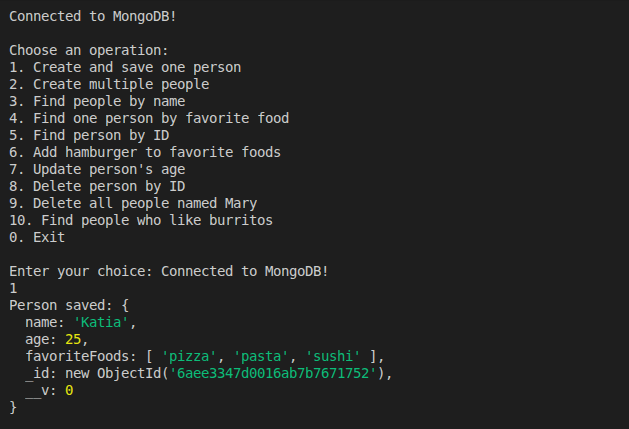
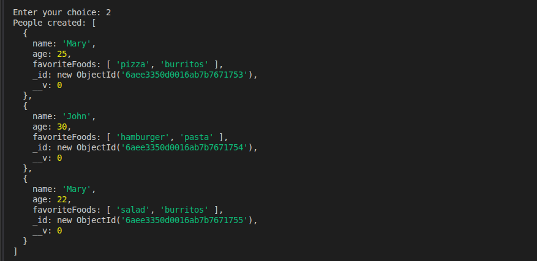
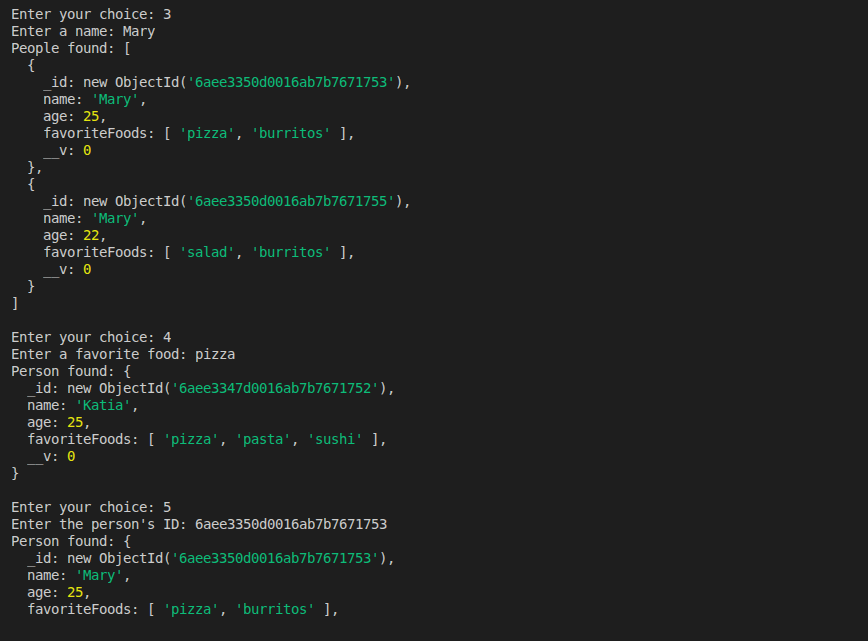
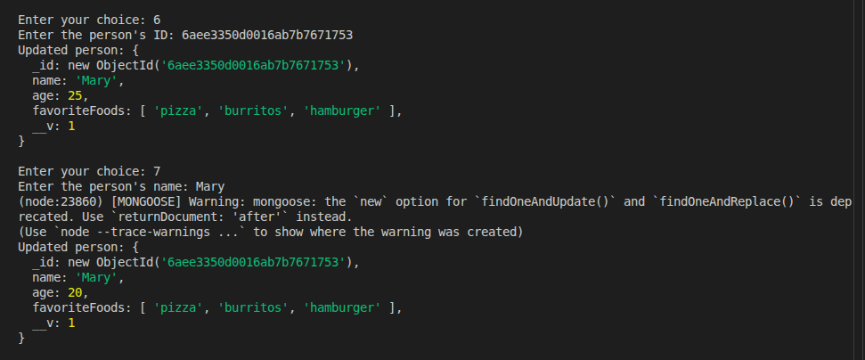
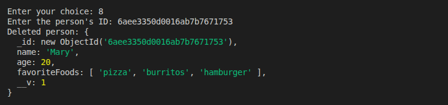
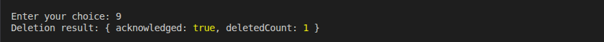
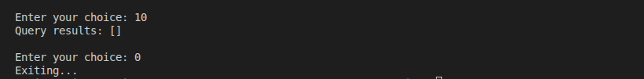

# GMC Mongoose Persons Checkpoint

This project demonstrates how to use **Mongoose** with MongoDB to perform basic database operations in Node.js.

## Work Completed

The checkpoint covers the following operations:

- Creating and saving a person using a Mongoose model.
- Creating multiple people using `Model.create()`.
- Finding people by name, favorite food, and ID.
- Updating a person's favorite foods and age.
- Deleting a person by ID.
- Deleting multiple people by name.
- Using Mongoose query helpers to filter, sort, limit, and select documents.

## Screenshots

### 1. Create and Save a Person

### 2. Create Multiple People

### 3. Find People

### 4. Update a Person

### 5. Delete a Person

### 6. Delete Multiple People

### 7. Query Helpers

